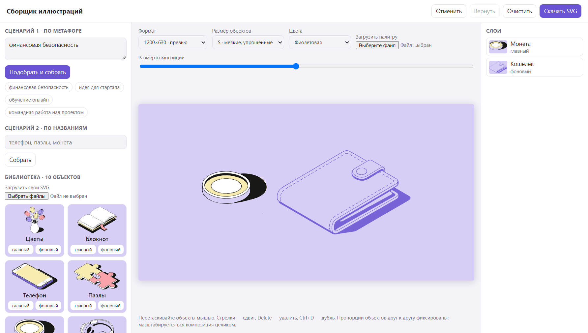
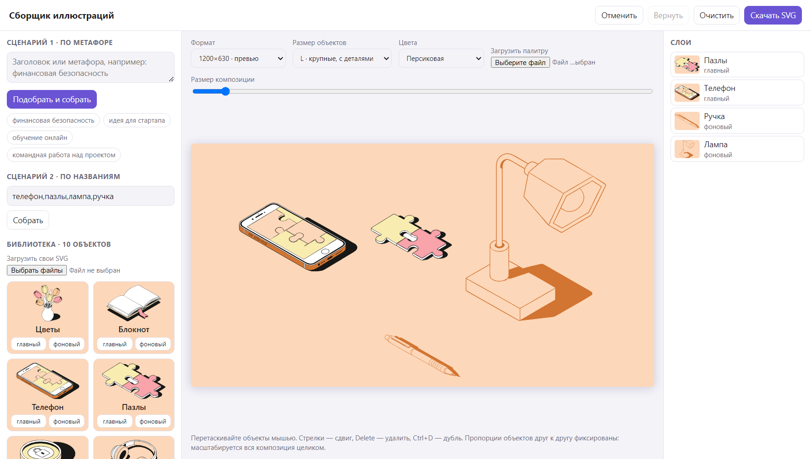
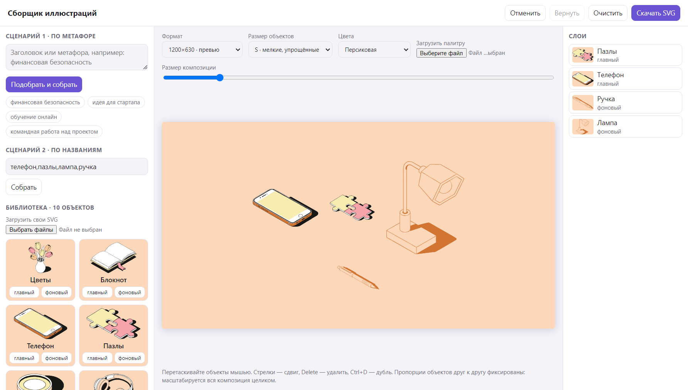
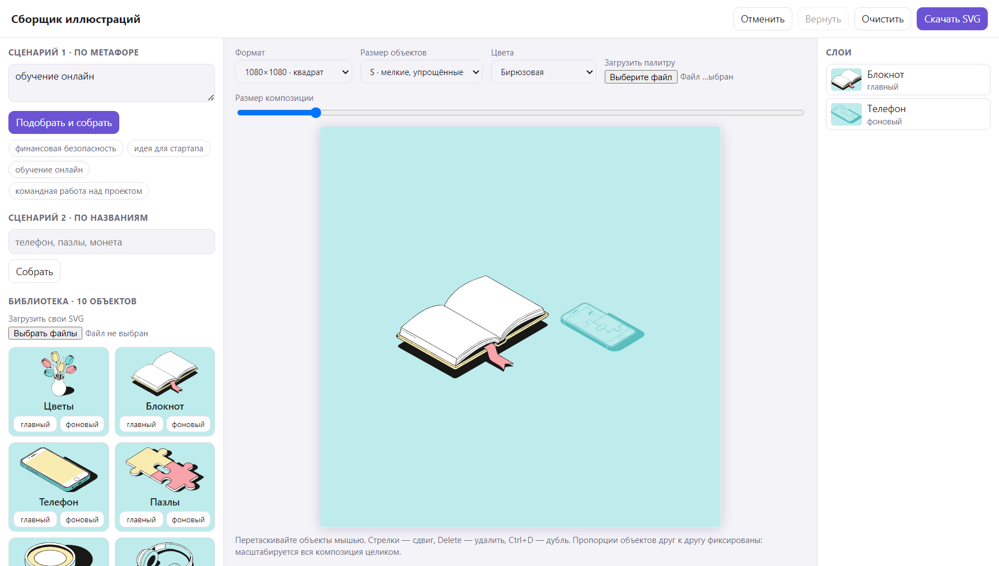
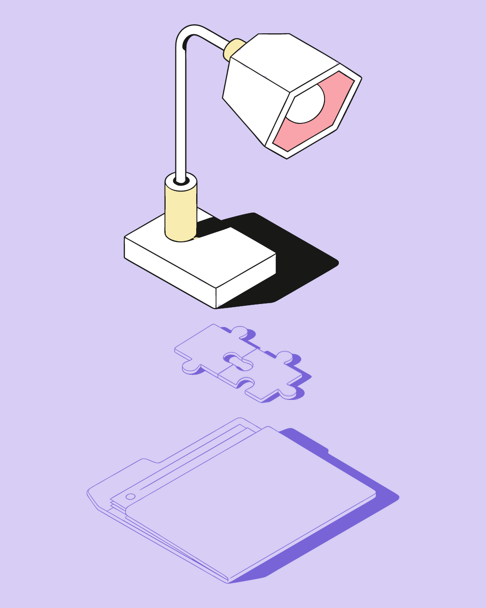

# Сборщик иллюстраций

**Онлайн:** https://kamilakuyanova.github.io/illustration-composer/

**Репозиторий:** https://github.com/KamilaKuyanova/illustration-composer

Веб-сервис, который собирает композиции для иллюстраций из готовых объектов исходной библиотеки (10 объектов × 2 состояния × 2 размера = 40 иллюстраций из Figma). Новые объекты не генерируются, форма объектов не меняется, результат остаётся векторным.



## Запуск

```bash
npm install
npm run dev        # http://127.0.0.1:5173
npm test           # тесты логики
npm run build      # продакшн-сборка в dist/ (пути относительные, подходит для любого хостинга)
npm run extract    # пересобрать public/library.json из source/*.svg
npm run examples   # пересобрать примеры композиций (SVG и PNG) в examples/
```

Композицию можно задать адресом, это удобно для демонстраций:
`/?q=идея для стартапа&size=L&scheme=peach&format=sq`
(`q` — метафора или `names` — названия через запятую; `size` — S или L; `scheme` — violet, teal, peach; `format` — og, sq, portrait, wide).

## Что умеет

- **Сценарий 1 · по метафоре.** Ввод заголовка («финансовая безопасность») → сервис подбирает объекты по тегам и собирает композицию.
- **Сценарий 2 · по названиям.** «телефон, пазлы и лампа» → композиция из этих объектов.
- **Ручная сборка:** добавление из библиотеки, перетаскивание, поворот, дублирование, удаление, порядок слоёв, отмена/возврат (Ctrl+Z).
- **Состояния объекта:** главный (цветной, с контуром) или фоновый (монохромный).
- **Размер объектов S / L.** S — мелкие упрощённые версии, L — крупные с дополнительными деталями (на телефоне видны пазлы, на монете замок). Это два разных набора из Figma, а не масштабирование одного.
- **Форматы кадра:** 1200×630, 1080×1080, 1080×1350, 1920×1080.
- **Цветовые схемы:** фиолетовая, бирюзовая, персиковая из Figma; своя палитра загружается файлом (JSON, CSS, TXT, SVG: из него берутся hex-цвета).
- **Своя библиотека SVG.** Кнопка «Загрузить свои SVG»: каждый верхний элемент или группа файла становится объектом, который можно искать по названию и собирать вместе со встроенными. Из загруженных файлов вырезаются скрипты и обработчики событий.
- **Экспорт в SVG:** каждый объект — отдельная группа (`<g id="Телефон-1" data-name="Телефон" data-state="главный">`), внутри исходные `<path>`. Файл открывается и редактируется в Figma, Illustrator, Inkscape.

## Демонстрация

Размер L, персиковая схема, сценарий 2 («телефон, пазлы, лампа, ручка»):



Те же объекты в размере S:



Сценарий 1 («обучение онлайн»), бирюзовая схема, квадратный кадр:



## Правила из ТЗ и где они обеспечены

| Правило | Как |
| --- | --- |
| Нельзя менять объект и его элементы | Объект — неизменяемая строка SVG; приложение только оборачивает её в `<g transform>` ([src/lib/compose.ts](src/lib/compose.ts)). |
| Нельзя менять пропорции объектов друг относительно друга | Масштаб один на всю композицию (`Composition.scale`), у экземпляров собственного масштаба нет. |
| Можно менять расположение и состояние (главный/фоновый), цвета | `Item { x, y, rot, state }`, схема цветов — часть композиции. |
| Нельзя нарушать цветовую схему | Перекрашиваются только три тона схемы (светлый, средний, тёмный); контуры, блики и акценты не трогаются ([src/lib/palette.ts](src/lib/palette.ts)). |

## Архитектура

```
Figma ──экспорт SVG──▶ source/S.svg, source/L.svg ──scripts/extract.mjs──▶ public/library.json ──▶ приложение
                                                                                      ▲
                                      «Загрузить свои SVG» (src/lib/customSvg.ts) ────┘ (объекты добавляются в память)
```

1. **Хранение.** Исходные иллюстрации лежат в `source/` (экспорт секций «Размер S» и «Размер L» из Figma). `scripts/extract.mjs` разбирает их в `public/library.json`. У каждого объекта хранятся имя, теги и четыре варианта (S/L × главный/фоновый): рамка и SVG-разметка.
2. **Извлечение элементов.** Figma при экспорте не сохраняет группы и имена слоёв, получается плоский список из ~1500 `<path>` на набор. Объекты выделены по порядку путей: каждый объект — непрерывный диапазон. Границы диапазонов найдены кластеризацией рамок путей и проверены глазами (галерея всех 40 вариантов). Имена и теги для поиска лежат в `scripts/names.json`.
3. **Переиспользование.** Приложение загружает `library.json` и рисует любой объект как `<g transform="translate rotate scale">` с исходными `<path>` внутри. Перекраска делает замену `fill`/`stroke` по карте тонов схемы. Никакой растеризации нет.
4. **Подбор по метафоре.** Запрос разбивается на слова, слова приводятся к основе (отбрасывается окончание, сравниваются первые 5 букв) и сравниваются с названием и тегами объектов. Совпадение слова с названием объекта даёт дополнительный вес. Лучшие объекты становятся композицией: первые главные, остальные фоновые ([src/lib/library.ts](src/lib/library.ts)).
5. **Автосборка.** Объекты раскладываются рядами. Общий масштаб подбирается так, чтобы ряды вместе поместились в кадр, а реальные размеры объектов друг к другу сохранились. При размере S композиция занимает ~60% кадра, при L ~90%. При переключении S↔L масштаб пересчитывается так, чтобы объекты на кадре стали крупнее и подробнее.
6. **Состояние UI.** `useReducer` с историей для отмены ([src/state.ts](src/state.ts)); холст — один `<svg>`, перетаскивание через pointer events.

## Ограничения

- Подбор по метафоре идёт по словарю тегов, без ИИ. Слова вне словаря сервис не поймёт, а подскажет доступные названия. Правила задания разрешают ИИ для анализа метафор, поэтому следующий шаг — подключить языковую модель, чтобы она подбирала объекты по смыслу заголовка.
- У загруженных пользователем SVG нет состояний «главный/фоновый» и размеров S/L: все варианты одинаковы. Перекраска у них работает только для цветов, заданных атрибутами `fill`/`stroke` в формате `#RRGGBB`.
- Загруженная библиотека хранится в памяти страницы и после перезагрузки сбрасывается.

## ИИ-инструменты при разработке

Claude Code (модель Claude Sonnet 5.5): разбор Figma-экспорта, написание кода и тестов, проверка в браузере.
Также ChatGPT

## Примеры композиций

Собраны тем же кодом, что и приложение (`npm run examples`): у каждого есть SVG и PNG-превью в [examples/](examples).

| Композиция | Метафора | Формат | Схема | Размер |
| --- | --- | --- | --- | --- |
| `finansovaya-bezopasnost` | финансовая безопасность | 1200×630 | фиолетовая | S |
| `ideya-dlya-startapa` | идея для стартапа | 1080×1080 | персиковая | L |
| `obuchenie-onlayn` | обучение онлайн | 1920×1080 | бирюзовая | S |
| `komandnaya-rabota` | командная работа над проектом | 1080×1350 | фиолетовая | L |
| `tvorchestvo-i-muzyka` | творчество и музыка | 1200×630 | персиковая | S |





